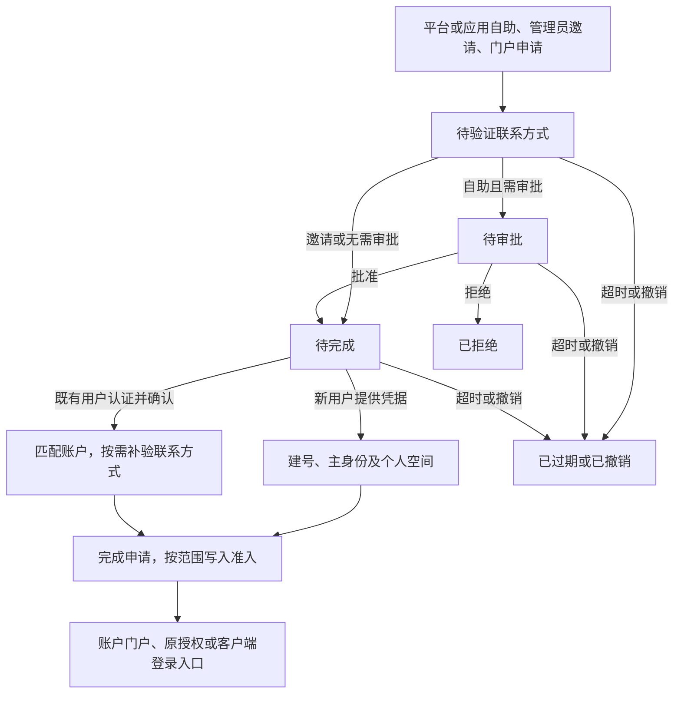

# Pero 注册流程梳理与最小闭环方案

基线为 `78dde9e`。范围覆盖建号、既有账户加入应用、组织邀请，以及这些流程前后的登录、验证、审批和 OAuth 回跳。建议保留现有注册页、两套业务记录和授权管线，把改动集中在入口上下文、申请恢复、既有账户确认和提交后回跳。当前主要问题是状态已经变化时，页面可能继续展示旧步骤，或无法把用户带回原申请、原账号和原应用。

## 一、现有入口与结果

| 入口 | 当前进入方式与后续 | 成功后的业务结果与去向 |
| --- | --- | --- |
| 平台公开注册 | 首页「注册账户」、登录页「创建账户」、直达 `/sso/register`。通常使用平台注册策略。无邀请时须为自助模式。邮箱或 E.164 手机号收到链接，显式确认后进入待审批或待完成。 | 新用户获得账户、主身份和个人空间。既有普通账户须认证匹配，可补验当前联系方式。进入账户门户。 |
| 应用主动发起注册 | `/oauth2/authorize?prompt=create`。校验应用、客户端、回调、scope、授权码能力及所需 PKCE，要求已配置合法的 HTTPS `login_uri`。进入同一个注册页，用目标应用策略。邮箱、手机、第三方路径汇入同一申请。 | 新用户建号并获得目标应用显式准入，主路径绑定其个人空间。既有账户用匹配会话确认准入，保留原请求的租户选择。可恢复时进入 OAuth 授权，超时或换设备后走客户端 `login_uri`。 |
| 应用登录页内的「创建账户」 | 普通 OAuth 授权进入 `/sso/login` 后，登录页的注册链接也指向 `/sso/register`。注册页从浏览器 OAuth nonce 读取待办请求，因此这个入口目前也可能走应用策略。 | 形成应用申请后，后续与应用主动注册相同。缺少 `login_uri` 时，页面可先展示表单，提交时才失败。 |
| 第三方登录或注册 | 登录页第三方按钮、注册页第三方按钮都进入 `/sso/social/{provider}/login`。回调先识别已绑定身份，其次判断能否关联已有邮箱账户，其余进入新注册。未绑定且 IdP 返回邮箱时会自动排队验证邮件，无邮箱则回页面补填。普通 OAuth 登录带待办请求时也可在回调进入应用注册。 | 已绑定身份直接登录。可关联账户走独立凭据确认。新身份经本站邮箱验证和可能的审批后建号。对于组织邀请，邀请邮件证明目标邮箱，第三方提供登录凭据。 |
| 管理后台发送平台注册邀请 | 用户列表「新建用户」使用 `/dashboard/users/new`，具备 `users.create` 的委派管理员或超级管理员可用。超级管理员也可从 `/dashboard/registration` 发邀请。邮件进入 `/sso/register?token=…`，显式确认邮箱，邀请跳过审批。 | 创建平台账户或由匹配的既有普通账户确认。进入账户门户。委派管理员的入口只发平台邀请。 |
| 管理后台发送应用邀请 | 超级管理员通过应用详情「注册策略与邀请」进入 `/dashboard/registration?app=…`，向指定邮箱发邀请。可记录域名例外理由。邮件验证、确认身份后完成。记录绑定应用，没有来源客户端。 | 授予目标应用显式准入。账户门户可打开已配置的应用主页。组织专用应用即使已有个人应用准入，登录时仍需一个符合条件的组织租户。 |
| 账户门户申请加入应用 | 已登录用户在 `/account/applications` 使用「申请加入」或「申请独立准入」。服务端根据账户联系方式自动选邮箱或手机，经通知、验证、可选审批和完成。OAuth 应用无权限页也会把用户引到这个门户，原页可重试授权。 | 为现有账户授予显式准入，或把组织来源准入升级为显式准入。门户申请本身不保存 OAuth 客户端。已停用的准入保持停用。 |
| 组织后台邀请成员 | Owner/Admin 在组织详情发送邮件，调用 `POST /account/tenants/{id}/invitations`。Owner 可邀请 admin/member，Admin 只可邀请 member。收到 `/sso/register?invitation=…`。新账户选择密码或第三方身份，已有账户登录并匹配邀请邮箱，平台管理员额外做近期认证。 | 事务中完成建号和入组，或只入组。返回组织详情。已是活跃成员时，消费邀请并保留原角色。 |
| 应用邀请组织成员 | `POST /api/tenants/{id}/invitations`。使用含 `tenant.manage` 的有效应用访问令牌校验组织上下文、调用者和权限，并从令牌记录来源客户端。接受流程同组织后台。 | 接受后返回来源客户端的 `login_uri`，携带目标 `tenant_id`，应用应发起新授权。组织成员资格和应用访问资格分别判断。 |
| 通知链接与门户继续办理 | 邮件、短信、审批通知中使用 `?token=…`，组织邮件使用 `?invitation=…`。有效令牌写 HttpOnly Cookie 并跳回干净 URL。已登录用户可在 `/account/applications` 查看 `enrollments` 记录并继续、重发或撤回。组织邀请的管理列表在组织详情，收件人从邮件进入。 | 继续当前申请、进入只读状态，或由管理方重发。注册页的「退出本次注册流程」离开浏览器流程，门户「撤回申请」会改业务记录状态并取消待发通知。 |

入口代码见 [首页](../frontend/src/home.tsx#L61)、[登录入口](../frontend/src/auth.tsx#L311)、[OAuth 授权](../services/user-center/src/web/oauth2/authorize.rs#L167)、[第三方回调](../services/user-center/src/web/sso/social.rs#L256)、[后台用户邀请](../services/user-center/src/web/dashboard/users.rs#L94)、[后台注册邀请](../services/user-center/src/web/dashboard/enrollment.rs#L91)、[门户申请](../services/user-center/src/web/account/admission.rs#L78)、[组织路由](../services/user-center/src/web/account/mod.rs#L31)和[应用组织邀请](../services/user-center/src/api/tenant_management.rs#L188)。

首次部署的超级管理员由 bootstrap 初始化。密码找回、已有身份关联、管理员直接授予应用权限，以及已有用户创建组织是独立流程。注册中遇到这些操作时，需要提供恢复原申请的路径。

## 二、现有流程与状态

### 平台和应用申请

- 平台默认仅邀请，审批默认开启。应用可继承或独立配置。平台紧急停止覆盖应用和组织邀请。邮箱域名按规范化后的完整域匹配。手机号仅限自助、无邮箱域限制且短信渠道可用。第三方注册源必须启用并允许注册，第三方自助路径依然需要本站邮箱。管理员邀请可以记录域名例外，仍要求邮箱验证。
- 普通申请有效 24 小时，平台和应用邀请 72 小时，组织邀请 7 天。OAuth 待办默认 600 秒，第三方注册证明有效 10 分钟。申请与 OAuth 待办是两个不同时钟。旧授权过期后，已创建的申请仍可办理。
- 审批决定和重发会轮换办理链接，保留原到期时间。审批设置变更会重新计算未人工批准、已验证的申请状态。后台删除待发任务和写入新任务都在事务内。通知入队成功后，实际投递由后台异步处理。
- 注册完成在事务里写入账户、主身份及应用准入，并消费申请。个人空间由用户插入触发器创建。已停用的应用准入会阻止完成，源于组织的活跃准入可升级为显式准入。注册只建立 SSO 会话，应用授权仍经过现有的 MFA、租户、同意和授权码流程。
- `enrollments` 使用 `pending_verification → pending_approval / ready → completed`，也可到 `rejected / revoked / expired`。终态可用当前链接读状态，办理接口拒绝终态。到期约 30 天后清理历史记录。应用停用、身份源退出或邀请人失权也会影响继续办理。

依据见 [申请服务](../services/user-center/src/service/enrollment.rs#L389)、[验证与审批](../services/user-center/src/service/enrollment.rs#L484)、[注册事务](../services/user-center/src/service/enrollment.rs#L610)、[个人空间触发器](../services/user-center/migrations/001_init.sql#L1773)、[授权恢复](../services/user-center/src/web/login_flow.rs#L187)和[清理任务](../services/user-center/src/db/helper/cleanup.rs#L290)。

### 组织邀请

组织邀请使用 `tenant_invitations`。有效的 `pending` 邀请在注册页呈现为待完成。新账号的邮箱来自邀请本身，既有账号需持有效会话并匹配邮箱。新建账号受平台关闭策略约束，既有账号仍可在平台注册关闭时受邀加入。全局紧急停止同时阻止两者。接受时复核组织状态、容量、邀请人当前角色、受邀邮箱和账号状态。接受成功写入 `accepted` 和 `accepted_user_id`。撤销或过期后只能查看结果。应用来源只影响回跳，应用是否可用继续由 OAuth 应用准入和租户规则判断。见 [组织邀请签发与接受](../services/user-center/src/service/tenant.rs#L415)。

## 三、已确认的断点

| 优先级 | 当前问题 | 影响与代码依据 |
| --- | --- | --- |
| P0 | 应用注册来源依赖同一组浏览器 Cookie。直接进平台注册页、从普通 OAuth 登录点注册，以及不同标签页同时开应用或组织申请，可能共用或覆盖上下文。GET 会清理部分冲突，但 POST 优先取当前 Cookie，表单没有绑定当时呈现的申请。 | 用户可在旧页面提交到另一流程，或者丢失来源。应用注册在开始前超时也走取消回跳。见 [注册上下文读取](../services/user-center/src/web/sso/register.rs#L117)、[页面选择](../services/user-center/src/web/sso/register.rs#L205)、[提交分派](../services/user-center/src/web/sso/register.rs#L636)。 |
| P0 | 「登录已有账户」和「使用第三方凭据注册」都把第三方回跳设为注册页。身份解析先按通用登录逻辑查找绑定、建议关联或注册。普通注册的第三方证明只匹配应用、身份源和 subject。 | 纯登录可走入新注册、修改待办的凭据来源或进入账户关联。恢复过期第三方证明时，页面列出所有开放身份源，判断相同身份较晚。组织新用户的邮箱已经由邀请指定，通用关联分支仍可能把人带去另一个邮箱账户的关联页。见 [按钮](../frontend/src/enrollment.tsx#L51)、[账户登录按钮](../frontend/src/auth.tsx#L329)、[第三方身份解析](../services/user-center/src/service/social/service_impl.rs#L369)、[注册回调](../services/user-center/src/web/sso/register.rs#L823)。 |
| P0 | 门户发起的应用申请只保存联系方式，完成时按该联系方式重新寻找用户。 | 原账户更换或移除联系方式后，流程可能被解释成新用户建号，或要求当前持有该联系方式的另一账号继续。关闭、停用应用或准入已禁用、管理员账户限制及渠道不可用也主要到提交后才反馈。通知选路只看账户是否有邮箱和通道配置，未按域策略综合选择或提示可用联系方式。见 [门户申请](../services/user-center/src/web/account/admission.rs#L78)、[申请入库](../services/user-center/src/service/enrollment.rs#L475)、[完成时识别账户](../services/user-center/src/service/enrollment.rs#L610)。 |
| P0 | 账号/准入提交与登录、回跳分两步，注册页先清 Cookie。会话失败只日志记录和清会话。 | 应用可能进入普通登录/授权，门户要求重新认证，用户看不到「已经完成」。重复点击或提交响应丢失时，终态申请的办理接口返回通用不可用。原授权在跳转后才失效时，OAuth resume 直接报错。见 [完成分派](../services/user-center/src/web/sso/register.rs#L743)、[提交后会话与回跳](../services/user-center/src/web/login_flow.rs#L187)、[OAuth resume](../services/user-center/src/web/oauth2/authorize.rs#L396)。 |
| P1 | 发送后页面仅有「已排队」。审批与重发覆盖旧令牌，旧页面刷新可能清 Cookie 回到新注册。取消审批要求时只改状态。 | 尚无账号的人依赖收齐每一条通知。首条未收到、决议通知丢失、审批取消或链接被轮换时，缺少同一申请的进度和自助恢复。重复提交自助表单也会新建申请。见 [等待画面](../frontend/src/enrollment.tsx#L209)、[轮换及审批](../services/user-center/src/service/enrollment.rs#L505)、[策略状态更新](../services/user-center/src/service/enrollment.rs#L223)。 |
| P1 | 已有账户会进入认证确认，但自助请求仍可重复入库，并可能先进入审批。 | 平台重复建号、已获应用准入、确实需要申请加入这三类请求可能都经历一轮通知和审批。当前完成事务可以复用账户和已有准入，但用户仍要逐条办理重复申请。见 [发起与验证](../services/user-center/src/service/enrollment.rs#L465)、[匹配账户与写入准入](../services/user-center/src/service/enrollment.rs#L659)。 |
| P1 | 页面按几个布尔值和全局 mode 分支，后端资格规则更细。「返回登录」直接进入通用登录。注册页的自助/手机号/组织文案也有混用。 | 申请遇到策略收紧、应用停用、先前账号已登录、身份源关闭、第三方邮箱渠道失效，或进入无效链接时，容易只得到通用错误或错误的下一步。只有短信渠道时，初始页仍可列出需要邮件的第三方注册入口。申请批准分支也未执行完整资格复核。见 [渲染逻辑](../services/user-center/src/web/sso/register.rs#L297)、[页面分支](../frontend/src/enrollment.tsx#L69)、[后台决定](../services/user-center/src/service/enrollment.rs#L519)。 |
| P1 | 组织邀请重发目前靠重新发邀请，由新记录撤销旧记录。该通知只关联发送者。停用组织的邮件页显示已撤销，但组织邀请列表只按过期与存储状态显示。 | 重发或撤销后，旧待发任务可能继续发出不可用链接，已发的旧链接也缺少明确的下一步。既有成员重新接受时应显示「已在组织」，保持当前角色。见 [签发与撤销](../services/user-center/src/service/tenant.rs#L470)、[邀请状态](../services/user-center/src/service/tenant.rs#L547)、[组织邀请列表](../services/user-center/src/service/tenant.rs#L188)。 |
| P1 | 接入示例的 `/login` 忽略 `tenant_id`、`enrollment_status`，且没有主动注册入口。OAuth 无准入页只给通用门户链接，申请完成后无法直接回同一应用，原页过期只提示手工返回。 | 业务应用容易在换设备、超时、取消或从组织邀请回跳时丢租户，或不能继续授权。已有应用会话时，示例还会直接回首页。见 [接入示例](../examples/tenant-app/app.py#L85)、[OAuth 准入恢复页](../frontend/src/auth.tsx#L79)、[客户端回跳契约](registration-invitation-design.md#应用配置和回调)。 |

后台文档中有一处「撤销访问后仍可通过注册或邀请重新获得资格」。当前服务把撤销和主动退出都写为禁用，最终办理拒绝禁用准入。本方案采用当前运行语义，由管理员显式恢复。普通申请也不会给平台管理员直接写入应用准入。管理员本人应走相应管理入口或既有授权。见 [主动退出](../services/user-center/src/service/account_security.rs#L215)、[完成时准入校验](../services/user-center/src/service/enrollment.rs#L738)和[历史说明](admin-permissions-design.md#L102)。

## 四、最小改动方案

### 1. 把入口来源和操作目的绑定到当前流程

- 保留 `/sso/register`、通知链接和现有 OAuth 端点。平台入口明确开启平台流程。OAuth `prompt=create` 进入明确的应用流程。普通 OAuth 登录页保留「注册此应用」，由服务端基于其有效的待办生成应用注册入口。首次第三方登录发现新身份时，同样需要明确当前是平台还是该应用。缺少合法 `login_uri` 或请求无效时给出受控返回或说明。通用登录页维持独立平台入口，既有账户确认登录页显示返回当前办理。
- 在现有签名 Cookie/回调状态中保留来源、办理对象、OAuth 请求与客户端匹配信息以及操作目的。注册表单带服务端签发的当前流程标识，提交校验该标识和 Cookie 仍指向同一办理对象。多标签页选中另一申请后，旧页提示刷新或重新打开对应通知。原 OAuth 仅凭匹配的 nonce 恢复。已建立申请以数据库持久化的来源为准。
- 第三方区分「登录既有账号」「新账号注册/受邀建号」「为当前申请刷新证明」。前者接受已绑定身份，未绑定时回原流程并提示用原登录方式。注册时遇到账号冲突，走独立登录并回原申请，关联仍通过明确操作和现有凭据校验。刷新证明只列原身份源、匹配同一 subject 和具体申请或邀请，验证通过后回到原步骤。组织邀请的注册邮箱始终由邀请确定。用户拒绝授权、回调超时、身份源停用，或需要找回密码、完成 MFA 时，使用经过校验的内部返回路径。回到原步骤时重新核对有效期，失效时引导重开或使用最新邀请。
- 原授权在创建申请前失效，返回来源客户端重新发起，并提示授权已过期。离开、取消授权、撤回申请分别有自己的动作和结果。应用原授权有效时的取消沿用 `access_denied` 和原 state，过期或跨设备时用已登记的 `login_uri` 和约定状态。用户主动取消注册视图时保留可继续办理的申请，真正撤回走事务内终止操作。用于退出、关闭提示、只读查看的动作有独立限流语义，发送、验证、完成继续做 CSRF 与防滥用检查。

落点在 [统一注册入口](../services/user-center/src/web/sso/register.rs)、[第三方入口](../services/user-center/src/web/sso/social.rs)、[授权入口](../services/user-center/src/web/oauth2/authorize.rs)和 [Auth 页面](../frontend/src/auth.tsx)。

### 2. 把申请进度与邮箱、短信办理链接分开

- 发送成功或有效链接进入后发放一份短期签名的进度凭据，绑定申请 ID 和用途。发送时置入 HttpOnly Cookie，必要时在验过联系方式后给出继续查看入口。进度凭据可在链接轮换后读状态。验证和完成仍要求当前办理令牌和原有认证。首次发送到验证之前仅展示提交状态、渠道和脱敏联系方式。有效期、拒绝原因及完成结果按证明等级展示。签名有效期封顶，状态以申请记录和清理期限为准。
- 同一浏览器持有带重发用途的进度凭据时可受限重发原申请，保留原到期时间、只投递原联系方式，并应用现有联系方式与 IP 限流及最短重发间隔。只读能力不用于重新签发可直接办理的令牌给浏览器。重复开始同一流程复用该浏览器已有的有效申请。清空 Cookie 或换设备，默认使用最新通知。面向无入口用户提供统一提示的重新收信路径，邀请由有权限的发件方重发，自助由原平台或原应用重新开始。未知链接、旧链接、已过期和已撤销分别显示明确的下一步。
- 前端由服务端返回当前步骤和可执行动作，已排队状态以业务记录为准。待验证显示验证或重发，待审批显示进度，待完成根据既有账户、登录状态、MFA、原第三方证明显示下一步。用户在打开的页面可主动刷新状态。批准与拒绝使用现有通知通道。旧链接在已经建立受限进度凭据的浏览器里可以进入只读状态。策略关闭审批导致已验证申请变为就绪时，同一记录可立即继续。拒绝、撤销、过期、完成页显示原因和可执行的返回动作。
- 将组织邀请的待发通知按邀请记录关联。优先复用 outbox 的通知 ID，在邀请行存可空的当前通知 ID，重发、撤销或接受时取消尚待发送的任务，历史维持现有记录。已发出的旧链接维持无效且可解释。暂停、恢复、已是成员或容量不足时，申请页与治理列表使用一致状态含义。临时阻塞保留当前邀请并给出重新尝试路径。组织邀请继续由邮件提供，发件方从原组织或原应用重发。后台保留通道实际投递诊断。

委派管理员发出的平台注册邀请继续走现有权限边界。发送结果明确显示已排队，受邀者从通知继续办理。有投递或撤销问题时，通过现有注册管理台由超级管理员处理，收件人也可在已验证联系方式的账号门户处理。

落点在 [申请服务](../services/user-center/src/service/enrollment.rs)、[组织服务](../services/user-center/src/service/tenant.rs)、[通知服务](../services/user-center/src/service/notify.rs)和 [注册页面](../frontend/src/enrollment.tsx)。

### 3. 门户只为发起账户申请，提交阶段复核业务资格

- 门户申请新增可空 `requested_user_id`。由服务端用当前会话写入，完成时要求匹配同一活跃账户和原申请联系方式。账户已修改联系方式则引导重新申请，已停用或注销则明确终止。门户申请全程使用既有账户分支。门户的进度查询和继续操作优先按发起用户归属，已验证联系方式继续用于识别普通申请及收到的邀请。
- 对平台、应用、门户和后台邀请复用同一套资格判断，按各入口决定能否展示邮箱、手机、第三方与邀请动作。字段选择依据当前应用策略、联系方式和通道配置。门户无合格联系方式时跳到账户资料验证或更新联系方式。已禁用准入提示管理员处理。组织专用应用的自助入口走组织邀请或治理入口。管理员发出的应用邀请仍可赋予应用准入，若受邀者还没有可用组织，完成页提示下一步是由组织 Owner/Admin 邀请入组。
- 已有待办在验证、批准和最终提交前复核有效策略、账号/组织/应用状态、邀请人授权和身份源。全局暂停和临时通道故障提供保留记录的可恢复状态。组织邀请的新建账号继续使用现有的平台关闭约束，已有成员加入沿用组织治理规则。密码或用户名校验错误保留页面和申请。遇到并发冲突重新读取状态，用户名重复可重新填，联系方式已有账户则进入认证分支。
- 上线用增量迁移增加可空字段并更新 schema 验收。历史应用申请中 `app_id` 有值、`client_id` 为空的非邀请记录可能是门户申请，也可能是客户端删除后的应用申请。对这些未完成的旧记录保留有效期，完成时只允许使用已存在且经认证匹配的账户。无法匹配时从原入口重开。历史邀请、平台申请和已完成历史保持可读。

落点在 [门户申请](../services/user-center/src/web/account/admission.rs)、[资格检查与事务](../services/user-center/src/service/enrollment.rs#L271)、[存储定义](../services/user-center/migrations/001_init.sql#L1453)和 [schema 验收](../services/user-center/src/db/verify.sql)。

### 4. 已有账户的重复注册与重复申请

提交联系方式时一律给出相同的提交和查收提示。用户完成邮箱或手机验证后，若联系信息命中已有账户，提示登录该账户。已认证用户也可从门户查看归属于本人或本人已验证联系方式的待办。已有登录会话与账户不匹配时，引导切换账号并保留当前申请。正式处理继续要求匹配的有效会话、现有 MFA 和当前办理凭据。纯第三方账号可用已绑定的身份登录。新提供方返回相同邮箱时，须先认证原账户，身份关联继续走现有独立流程。

| 确认已有账户后的场景 | 重复申请的处理与下一步 |
| --- | --- |
| 平台自助注册或平台邀请，账户已存在 | 显示「你已有账户」，用已确认账号结束本次有效申请或邀请并返回门户。保持现有账号、密码、第三方身份和个人空间。对于该账号尚未验证的同一个联系方式，可在匹配会话及当前链接都有效时沿用显式补验。 |
| 目标应用已有活跃的显式准入 | 显示「你已拥有此应用的访问资格」。结束重复待办，退出该申请的审批队列并取消待发通知，然后继续当前可验证的 OAuth 授权或返回应用。继续校验应用 MFA、租户资格和授权同意。 |
| 尚无目标应用准入，或需把组织来源准入升级为显式准入 | 使用已有账号继续申请，可按业务范围复用一个有效待办及其进度。保留联系方式验证和适用审批，成功后只创建或升级该应用的准入。 |
| 目标应用准入已禁用，或账号已停用 | 禁用准入由管理员显式恢复。无法建立有效账户会话时提供账号恢复或管理员支持入口，使用统一提示。申请历史保留，重复申请无法恢复账户或准入。 |
| 已是目标组织的活跃成员 | 满足邀请校验后消费当前邀请，显示「你已在此组织」，保持原角色和成员关系，返回组织或来源应用。非活跃成员仍按组织治理规则办理。 |
| 上一申请已拒绝、撤回或过期 | 旧申请保持只读。仅在当前策略和权限允许时，由用户明确发起新申请或由授权人重发邀请。原申请历史及审批结果继续可查。 |

- 同一浏览器反复提交时，凭已签发的流程凭据复用同一申请。登录后可在账号归属及范围已验证的前提下跨设备识别同一活跃待办。匹配时考虑平台、应用或组织范围、办理目的和申请来源。申请与邀请各自保留权限和审批语义，不跨范围合并。
- 多个有效待办已经产生时，在既有事务内复核实时账号及准入状态。首个有效请求完成后，其余同范围请求在再次办理时返回已有结果并结束冗余待办。此路径只确认已有结果。需要新增或升级准入的申请依然执行审批，已有记录的 OAuth 请求 ID 保持不变。另一个浏览器可从已登记的应用登录入口新发授权。全局暂停时仍可走已有账号登录和原有准入，待办保留暂停状态。
- 复用现有终态和 `completed_user_id` 或 `accepted_user_id`。当前操作可显示「已有账户」「已拥有访问资格」或「已在组织」。重新打开历史时显示「此申请已处理」并给出下一步。重复点击、跨设备和并发重试都以已提交的账号、准入和成员关系为准。对未绑定且与已有账号没有相同联系方式的身份，保留主动登录已有账号并按原流程继续的选项。

### 5. 完成办理由事务结果驱动，统一回跳

| 结果 | 可执行的下一步 |
| --- | --- |
| 平台建号完成 | 有会话时进入账户门户。会话建立失败时显示账号已创建，通过普通登录进入门户。完成页重开仍显示结果。 |
| 门户加入或后台应用邀请完成 | 展示目标应用准入结果和「打开应用」。从无准入页进入门户的用户可回原授权页重试。请求过期后从已登记的客户端登录入口新发授权。后台直接邀请无来源客户端时，沿用门户应用主页。 |
| 应用注册完成且原授权可用 | 同浏览器、nonce 和请求 ID 匹配，客户端、回调、应用和原授权仍有效时，继续既有授权流程并保留 state、PKCE、nonce。个人新账号绑定个人空间。既有账号继续验证原请求的租户，需选择时按现有候选列表。原请求明确要求组织租户时，入口提示现有组织成员登录或联系组织管理员邀请。新用户可以另行明确发起个人空间注册。 |
| 应用注册已完成，原授权不可恢复 | 使用目标客户端已登记的 `login_uri` 及可用的租户提示，由客户端创建全新的授权。客户端或应用不可用时，在平台完成页说明并提供门户入口。注册完成状态仍可查询。 |
| 组织邀请已接受 | 无来源客户端进入组织详情。有来源客户端时进入 `login_uri` 并传目标 `tenant_id`。应用无准入时显示加入组织的结果，并由应用现有准入路径处理。组织停用或邀请无效时指向组织管理员。 |
| 用户退出或授权超时 | 有效原授权的主动取消返回 OAuth `access_denied` 和原 state。应用回跳页区分主动取消和需要新发授权的过期。已有已创建申请可用其受限进度入口继续。平台流程返回平台登录或门户。 |

OAuth 无准入页把现有绑定会话的恢复上下文传给门户。门户只接受与当前账号和目标应用一致的上下文，可在申请里复用现有 `client_id`、`auth_request_id`。原请求过期后仍可完成准入，凭客户端配置返回应用。后台邀请和普通门户申请继续使用现有应用主页路径。

重复 finalize、并发请求、提交后网络中断时，以 `completed_user_id` 或 `accepted_user_id` 标识既有结果。只读进度可确认结果。进入账号或自动恢复 OAuth 时仍校验真实会话、已验证的原请求及当前资格。结束流程时只清该流程拥有的 Cookie。示例应用补齐主动注册、取消状态、租户续接与新授权参数，已有业务会话遇到不同租户时走显式切换及授权确认。

落点在 [完成和回跳](../services/user-center/src/web/login_flow.rs#L187)、[应用准入恢复](../services/user-center/src/web/oauth2/access.rs)、[授权恢复](../services/user-center/src/web/oauth2/authorize.rs#L396)和 [接入示例](../examples/tenant-app/app.py#L85)。

## 五、验收矩阵

| 检查 | 最少覆盖 |
| --- | --- |
| 发起入口 | 首页、平台登录、普通 OAuth 登录、`prompt=create`、首次第三方登录、平台超级管理员和委派邀请、应用邀请、门户加入和组织来源升级、组织后台和应用 API 邀请。入口一旦识别，策略、目标和返回地址一致。 |
| 联系方式、策略与审批 | 邮箱和手机各过一次完整流程。覆盖第三方有无邮箱、单一通知渠道、域名限制和例外、仅邀请和关闭、紧急停止、批准和拒绝、审批开关变更、发送失败、重发节流、旧链接，以及账号或准入状态变化。 |
| 账户与凭据 | 覆盖新用户密码或第三方身份、已有密码或纯第三方账号、已登录账号是否匹配、MFA 和近期认证、第三方拒绝或回调过期、换身份和跨设备刷新证明、用户名重名、门户申请后联系地址变化。 |
| 已有账户重复申请 | 同一邮箱、手机号或已绑定第三方身份反复发起，覆盖同浏览器、跨设备、已有显式准入、无准入、组织来源准入、禁用准入、已是组织成员和旧申请已结束。确认首次建号或授予资格后，其余同范围申请有明确结束结果，且不会重复建号、改凭据、提权或跳过所需审批。 |
| 组织 | 新用户与已有用户、邮箱不匹配、已入组、来源客户端存在或已停用、邀请人失权、容量达到上限、停用组织、过期、撤销及重发。组织成员和应用准入分别验证。 |
| 恢复与终态 | 验证前超时、审批后原 OAuth 过期、跨设备、两个应用/邀请在不同标签页、主动退出和撤回、取消 OAuth 保留 state、会话创建失败、提交响应丢失、双击和并发重试。请求必须有下一步或明确终态，账户、成员和准入只写一次。 |
| 部署兼容 | 旧链接、已轮换链接、旧数据、签名 Cookie 过期、客户端配置变化、数据库增量迁移和既有客户端 `login_uri` 兼容。 |

实施顺序为入口和账号绑定，接着补状态恢复与回跳，再完成组织通知和接入示例。所有改动共用现有注册页、通知队列、注册及邀请事务和 OAuth 授权。新增持久化限于门户发起用户和组织邀请当前通知引用。进度凭据沿用现有签名机制。
