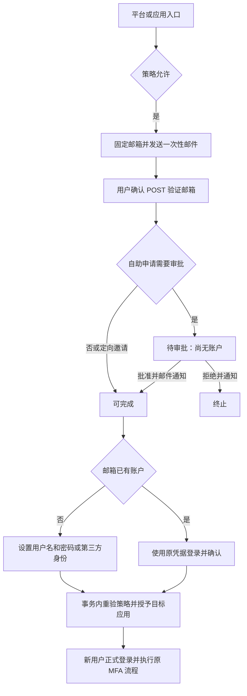

# 注册、邀请、应用准入与注销

状态：已实现；入口为 user-center，沿用现有 React/MUI 页面、SeaORM 与 PostgreSQL、Redis 限流、通知网关和管理门禁。

## 策略层级

共享用户目录只保存一个账户；每个应用独立控制加入资格。平台注册完成不授予业务应用访问资格。

| 层级 | 职责 |
| --- | --- |
| 全局安全要求 | 强制邮箱验证、身份唯一性、现有密码/MFA 要求；紧急停止覆盖全部准入流程 |
| 平台默认策略 | 平台入口及未覆盖的应用使用该模式、域名和审批要求；默认仅邀请 |
| 应用覆盖策略 | 关闭、仅邀请或自助注册；独立域名与审批开关，也可恢复继承 |

平台默认“关闭”不禁止应用显式配置自助注册；紧急停止会禁止全部应用完成注册及接受邀请。已有用户正常登录不受注册模式影响。

`auto_access` 已移除，避免与应用准入策略重复。应用流程完成后只授予该应用资格；系统应用不参与公开注册、邀请或自助退出，管理员角色继续独立分配。

## 共用申请流程

`enrollments` 同时承载自助申请和定向邀请；身份创建、应用加入复用同一服务，不增加通用规则或流程引擎。

申请状态为 pending_verification、pending_approval、ready、completed，以及 rejected、revoked、expired。完成前不创建用户、密码身份、SSO 会话或 OAuth 令牌。

为控制实现规模，一个申请只对应固定邮箱和至多一个应用；邮件使用高熵令牌，数据库只存哈希。令牌在邮件入口交换为 HttpOnly 流程 Cookie，地址栏移除令牌，GET 不验证邮箱、不接受邀请。后续 POST 使用 CSRF；流程 Cookie 不属于 SSO 会话。

自助申请 24 小时、邀请 72 小时；重发至少间隔 60 秒，轮换令牌、取消旧排队消息且不延长有效期。审批批准后轮换完成链接并发邮件；拒绝发送不含准入令牌的结果通知。邮件凭证也证明指定邮箱所有权，所以不重复发送第二封验证邮件。管理员无法从页面查询原始链接。

只有超级管理员可以配置策略、邀请、审批或重发，并要求现有 MFA、近期认证和 CSRF。邀请可对单封邮件设置域名例外，但必须填写原因，不能绕过邮箱验证或紧急停止。邀请是事前批准，不重复审批，也不能携带管理员权限。

## 应用与既有账户

通过具体应用入口完成的新注册，只创建一个共享账户和该应用的访问关系；直接平台注册不分配应用。应用选择来自有效应用及其当前策略，不把 OAuth 请求 UUID 当作授权依据。OAuth 请求仍独立校验，过期请求需重新从应用发起。

既有账户加入另一应用仍须满足该应用的模式、域名和审批要求。邀请和验证链接不能登录、重设密码、修改邮箱或合并现有账户；必须独立认证邮箱归属的原账户。邮箱已存在时不创建重复账户，也不覆盖密码。被停用、锁定或删除的账户不能借邀请恢复。

已有 active 的应用资格保持幂等，disabled 资格必须由管理员显式恢复；自助加入或邀请不自动恢复。邀请或申请批准只授予应用资格，OAuth consent、客户端状态、MFA 和协议校验继续独立执行。

域名由统一邮箱解析后规范化并精确匹配，不自动包含子域，不采用供应商特定的去点或加号截断。域名条件决定准入资格，不证明在职身份。

## 第三方身份

已有 `(provider_id,subject)` 绑定继续走原登录流程；未知身份必须进入上述申请流程。提供方有显式“允许参与注册”开关，默认关闭；开启后仍受全局与应用策略限制。

所有来源统一在本站验证邮箱，不引入可配置的上游邮箱信任层。没有邮箱的提供方先通过十分钟有效的服务端签名 Cookie 保存最少身份引用，再收集、验证邮箱。邀请流可以绑定该上游身份，但有上游邮箱时必须与邀请邮箱一致。

申请保存 Provider 和 subject，不保存上游 access/refresh token；完成浏览器必须持有与申请 Provider、subject 匹配的签名 HttpOnly 认证 Cookie；不能仅凭邮件链接或申请记录中的认证时间完成第三方注册。证明超过十分钟或跨浏览器时要求重新认证，回调绑定同一申请、同一提供方和同一 subject。邮箱冲突保留原有显式账户关联流程，禁止自动合并。

## 事务、撤销与运维

注册策略、申请完成、邀请操作及相关管理员/应用状态变更复用现有管理策略事务锁；应用/资格/用户锁沿用现有签发顺序。凭据哈希在事务前计算。账户、身份、应用访问关系、申请完成、成功审计和待投递消息均在相应事务内落库，失败回滚。

每次验证及完成按当前策略判断，不冻结历史政策。开启审批会把尚未批准的 ready 自助申请退回待审批；收紧域名或关闭模式即阻止完成。邀请方或审批方降级/停用会撤销其待处理流程，应用停用撤销所属待处理流程，不随恢复自动复活。

邮箱发起每小时最多三次，注册页面写请求每 IP 每小时十次；重发有冷却。Redis、数据库及通知配置故障不降级放行。通知使用现有加密 outbox、幂等投递及运维列表；增加 enrollment_id 归属以支持未创建用户的邮件，保持用户通知独立撤销。

过期判断始终在业务查询执行，不依赖清理任务。后台任务标记过期，申请过期超过 30 天后分批删除；通知元数据继续采用原有 30 天规则。日志只记录路径，注册页面采用 no-store 与 no-referrer。

## 三种注销操作

| 操作 | 影响 |
| --- | --- |
| 退出登录 | 沿用原登录会话与 OAuth 注销流程 |
| 退出应用 | 撤销该应用访问资格、consent、授权码和刷新令牌，推进授权版本；保留账户及其他应用 |
| 注销账户 | 近期认证、准确输入用户名二次确认；撤销全部登录状态与资格，删除身份凭据、MFA、联系方式和资料，保留审计引用 |

管理员必须先由其他超级管理员移除其管理员身份，才能注销账户。注销账户是不可恢复操作；不会删除外部业务应用持有的数据。用户记录使用脱敏用户名及 deleted_at 作为审计引用，不再保留可登录身份。

## 实施结构及验证

- `service/enrollment.rs`：策略、邮箱规范化、邮件申请、邀请、审批与事务完成。
- `web/sso/register.rs`：注册页面和受限流程；`web/dashboard/enrollment.rs`：管理；`web/account/admission.rs`：应用准入及注销。
- `service/account_security.rs`：复用会话/令牌撤销完成退出应用和注销账户。
- `frontend/src/enrollment.tsx`：复用现有表单、确认弹窗、布局和中英文词典。
- `005_enrollment.sql`：平台/应用策略、申请、通知归属及移除 auto_access；测试数据库夹具同步包含迁移。

已移除密码注册和第三方 callback 直接创建 active 用户，以及后台代设初始密码的路径。原有 bootstrap 保留为运维初始化入口。无需兼容旧注册请求或旧前端，新旧服务版本不能混合运行。

验证聚焦四个数据库场景：应用独立策略与完整账户生命周期、审批与紧急停止、邀请投递与轮换接受、第三方注册的浏览器认证证明绑定；辅以已有工作区检查、前端构建和浏览器用例。未引入独立服务、组织模型、自定义角色或可编排策略引擎。

## 参考

- [Keycloak 注册策略](https://www.keycloak.org/docs/latest/server_admin/index.html#_user-registration)：注册入口与身份代理必须分别受控；先邮箱验证再设置凭据。
- [authentik Invitation stage](https://docs.goauthentik.io/add-secure-apps/flows-stages/stages/invitation/)：固定邀请内容、流程前置校验与单次使用。
- [ZITADEL 用户入职](https://zitadel.com/docs/guides/integrate/onboarding/end-users)：区分邀请、验证、凭据设置与应用授权。
